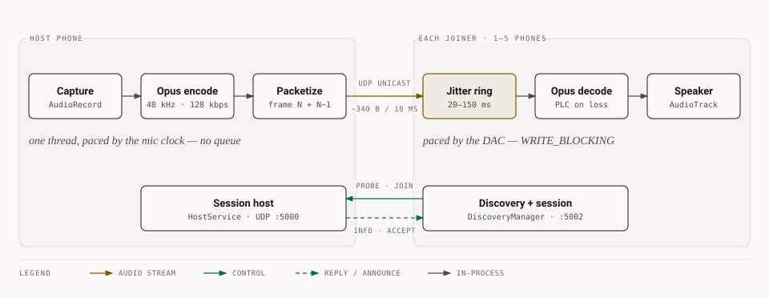
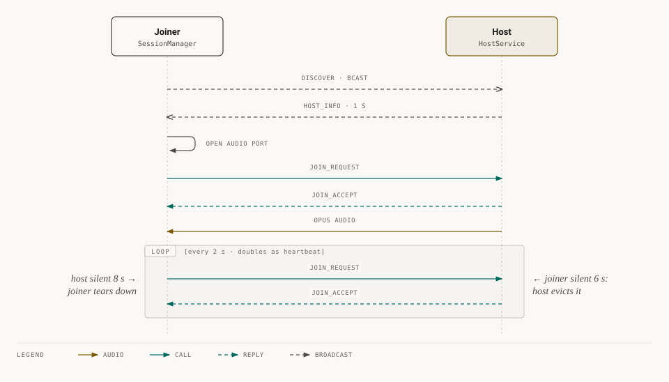
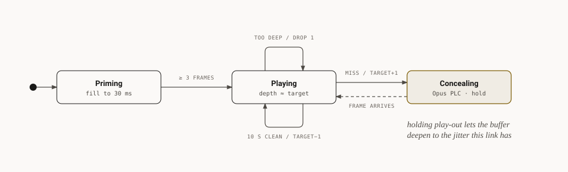

# Day Owl

[](https://skillicons.dev)

**Share whatever your phone is playing with everyone in the room.** One phone hosts, 1–5 others
join over local WiFi. No internet, no account, no pairing.

| Latency | Codec | Loss recovery | Discovery |
|:---:|:---:|:---:|:---:|
| **40–80 ms** | Opus 48 kHz mono, 128 kbps | every packet carries the previous frame too | automatic, both directions |

---

## How it works

The host captures **system audio** (`MediaProjection` playback capture, not the mic), encodes it
and unicasts it to each joiner. Nothing paces the stream except the hardware clocks, and there is
no unbounded queue anywhere, so latency stays flat.

<picture>
  <source media="(prefers-color-scheme: dark)" srcset="docs/diagrams/pipeline-dark.svg">
  
</picture>

### Connection lifecycle

The `JOIN_REQUEST` retry loop is also the heartbeat. A join that's never accepted gives up after ~5 s.

<picture>
  <source media="(prefers-color-scheme: dark)" srcset="docs/diagrams/lifecycle-dark.svg">
  
</picture>

### Adaptive jitter buffer

A lock-free 64-slot ring. Target depth starts at 30 ms and moves between 20 and 150 ms.

<picture>
  <source media="(prefers-color-scheme: dark)" srcset="docs/diagrams/jitter-dark.svg">
  
</picture>

---

## Use it

| | |
|---|---|
| **Needs** | Android 10+ on every phone, same WiFi with client isolation off. A phone hotspot works. |
| **1. Host** | Start a session, accept the screen-capture prompt. Audio only goes to your joiners. |
| **2. Join** | Pick the host from the list and tap Join. |
| **3. Play** | Keep the host app open with the screen on for the lowest jitter. |

> [!NOTE]
> Apps that opt out of capture (most DRM streaming services) come through silent. Android
> enforces that, not Day Owl.

## Build

```bash
./gradlew assembleDebug          # APK at app/build/outputs/apk/debug/
./gradlew testDebugUnitTest      # packet format + jitter-buffer logic
```

JDK 21, AGP 9.3.1, Gradle 9.5. Pushing a `v*` tag publishes a signed release APK
(`.github/workflows/ci.yml`).

## Code map

| Path | Role |
|---|---|
| `audio/AudioCaptureEngine.kt` | Host path: capture, packetize, fan out |
| `audio/AudioPlayer.kt` | Joiner path: RX thread + play-out thread |
| `audio/FrameRing.kt` | Jitter ring (pure JVM, unit-tested) |
| `network/AudioPacketizer.kt` | Wire format, zero allocation |
| `network/SessionManager.kt` | Joiner control plane |
| `network/DiscoveryManager.kt` | Broadcast discovery |
| `network/WifiNetwork.kt` | Pins sockets to WiFi |
| `service/` · `ui/` | Foreground services · Compose screens |

## Known limits

- **Not encrypted.** Fine for a living room, not for anything sensitive.
- **Screen-off hosting** keeps working but jitter rises.
- **Mono** only.
- **Not compatible with 1.1.x** (packet format v2).
